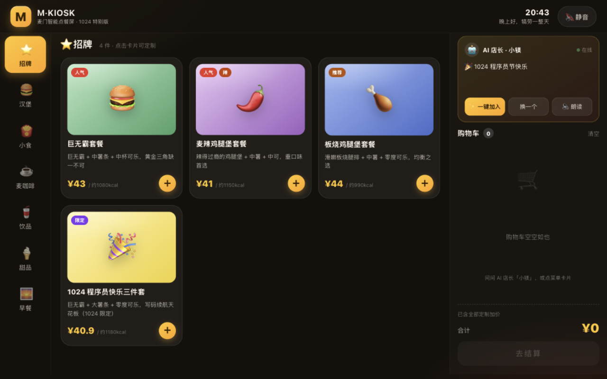
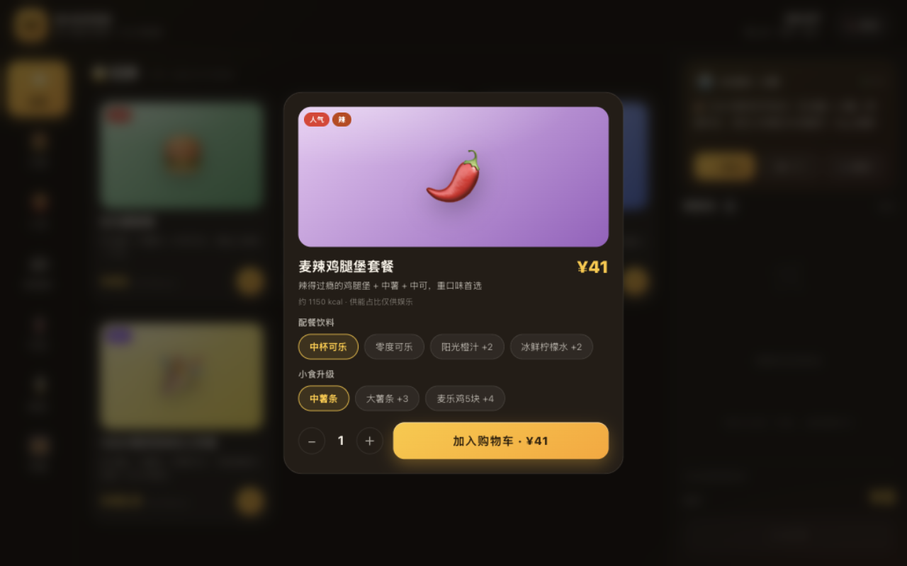
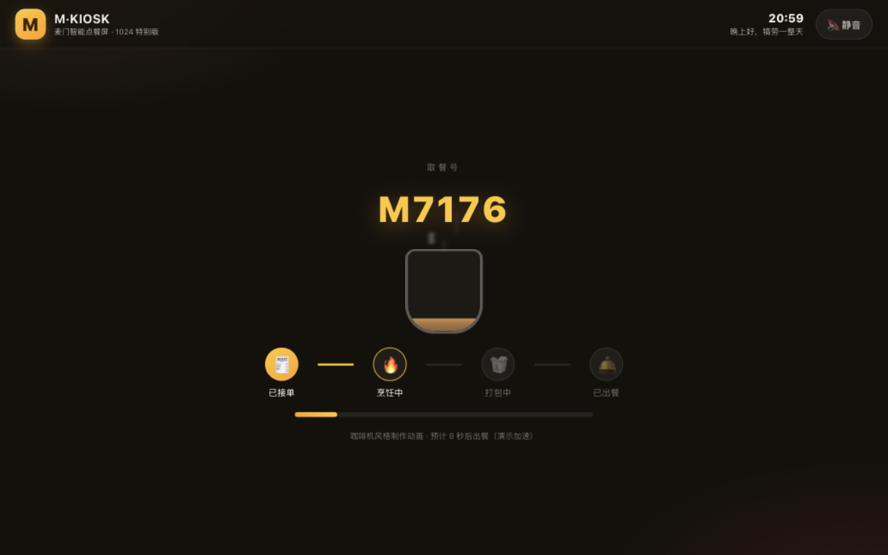
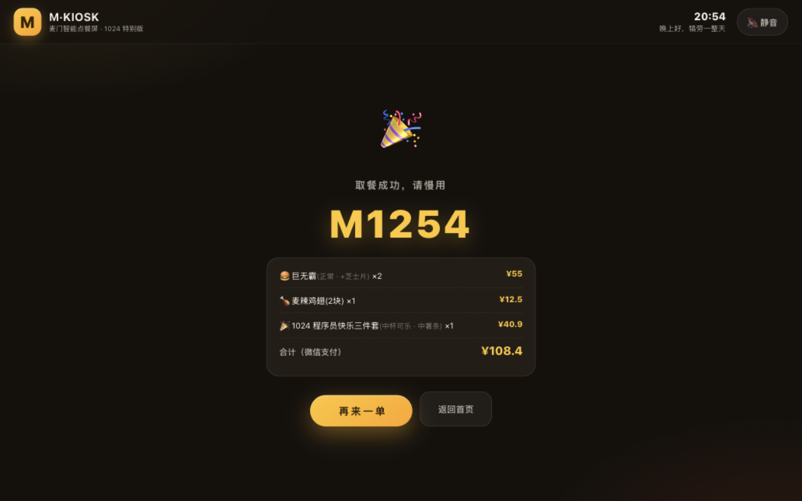
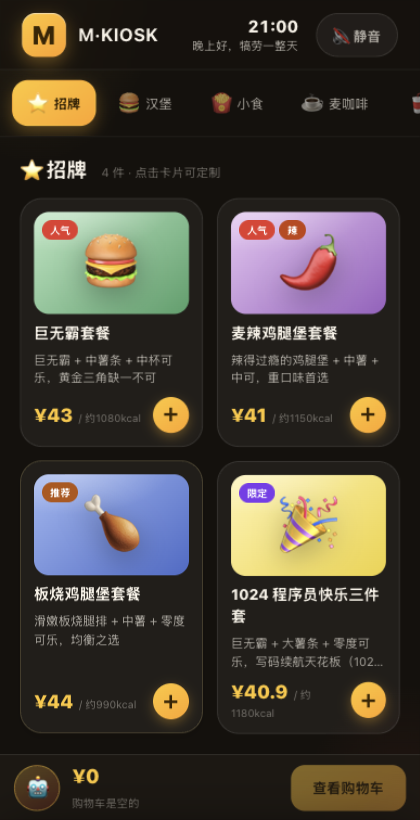

# M·KIOSK —— 麦门智能点餐屏（1024 程序员节特别版）

> 灵感来自麦当劳中国的 **1024 程序员节创意开发大赛**（[M-China/mcd-developer-innovation-challenge](https://github.com/M-China/mcd-developer-innovation-challenge)）与其 **官方 MCP Server**（麦当劳开放平台 [open.mcd.cn](https://open.mcd.cn) 提供的点餐/麦咖啡等 MCP 能力）。
> 本项目把「AI Agent 点餐」做成一台**咖啡机风格的触控点餐屏**：深色金属机身质感 + 麦当劳黄红点缀，AI 店长全程建议，语音播报默认静音。

纯静态、零依赖、无构建步骤 —— `index.html` 双击即用。



| 待机屏 | 商品定制 | 制作动画 |
| --- | --- | --- |
|  |  |  |

| 出餐小票 | 竖屏平板（≤960px 自适应） |
| --- | --- |
|  |  |

以上截图为 1280×800 kiosk 分辨率实拍（自动化浏览器验收时抓取）。

**目标用户**：快餐店/咖啡档口的自助点餐场景、ESP32/嵌入式爱好者的智能硬件桌面摆件、麦当劳主题门店的互动展示屏；也适合作为「AI + MCP + 嵌入式」结合的教学演示项目。

## ✨ 功能

| 模块 | 说明 |
| --- | --- |
| 咖啡机风格 UI | 暖黑机身 + 玻璃拟态卡片 + 表情艺术菜品图，横屏 kiosk 三栏 / 竖屏平板自适应 |
| 完整点餐流 | 待机屏 → 分类菜单 → 商品定制（杯型/冰量/糖度/加料/套餐换购）→ 购物车 → 模拟支付 → 咖啡注杯制作动画 → 取餐小票 + 彩带 |
| AI 店长「小镁」 | 本地规则引擎（时段 / 购物车内容 / 热量预警 / 节日彩蛋 15 条规则，加权随机不重复），支持一键加入、换一个、朗读 |
| 语音朗读 | Web Speech API 中文合成；**默认静音**，右上角 🔊 一键开启并记忆（localStorage）；静音时「朗读」按钮仍可手动播报单条 |
| 交互音效 | WebAudio 振荡器合成（点击/加购/成功/出餐叮），零音频文件 |
| 1024 彩蛋 | 10/20–10/31 AI 店长高频推荐「1024 程序员快乐三件套」 |

## 🚀 运行

```bash
# 方式一：直接双击 index.html（file:// 亦可）
open 1024-kiosk/index.html

# 方式二：本地静态服务
cd 1024-kiosk && python3 -m http.server 8024
# 浏览器打开 http://localhost:8024
```

推荐以 kiosk 分辨率体验：窗口 1280×800 或全屏。语音朗读需浏览器支持 Web Speech（Chrome / Edge / Safari 均可）。

### 📟 烧进 ESP32-S31 板子（板内伺服，无需电脑）

页面资源由 s31-image-viewer 固件**构建时直接嵌入**（`EMBED_FILES` 指向本目录源文件，单一来源，改页面重编译即生效）。板子既是图传服务器也是点餐屏服务器：

```bash
source /Users/lmt/ESP/switch-idf.sh 6.1
cd /Users/lmt/ESP/ESP32_S31_kit/s31-image-viewer
idf.py --preview -p /dev/cu.usbserial-10 flash
```

烧录后：手机连板子热点 `S31-IMG-C9D4`（或与板子同网段 Wi-Fi）→ 浏览器打开 `http://192.168.4.1/kiosk/`（SoftAP 模式）或 `http://板子STA-IP/kiosk/`。上传页 `http://板子IP/` 的标题下也加了「🍔 1024 智能点餐屏」入口。AI 店长 / 语音朗读 / 音效全部照常，语音默认静音。

## 🔇 关于「默认静音」

点餐屏常驻公共空间，突发外放不礼貌，且浏览器自动播放策略本就要求用户手势后才能出声，因此**语音默认关闭**：

- 右上角 🔇/🔊 按钮切换，选择持久化到 `localStorage`；
- 静音时 AI 建议仍可点「🔈 朗读」按钮单条手动播报；
- 如需改默认值：`js/voice.js` 顶部 `DEFAULT_ON = true`。

## 🤖 AI 建议引擎（MCP 适配层）

`js/ai.js` 对外只暴露一个接口，UI 与语音层不感知实现：

```js
AI.next(ctx)            // ctx = { hour, dow, date, cart:[{item,qty}], total, kcal, count }
// => { id, text, items:[itemId...] }   items 供「一键加入」
```

本地规则引擎是默认实现（离线可演示）。接入真实 **麦当劳官方 MCP** 的路线：

1. 部署官方 `mcd-mcp-server` 并获取凭证；
2. 把 `AI.next()` 替换为 MCP 工具调用：`menu.search`（实时菜单/价格替换 `js/menu-data.js` 的拟真数据）、`coupon.list`（券比价）、`order.create`（真实下单）；
3. 文案守则可参考大赛参赛作品《看人下菜》的经验：价格只信实时接口、下单前强制确认。

## 📁 结构

```
1024-kiosk/
├── index.html          # 单页 + 全部屏幕结构
├── css/style.css       # 咖啡机风格主题（横竖屏自适应）
├── js/menu-data.js     # 菜单 / 定制模板 / 标签配色（拟真数据）
├── js/ai.js            # AI 店长建议引擎（MCP 可替换适配层）
├── js/voice.js         # 语音朗读 + 音效（默认静音）
└── js/app.js           # 状态机 / 购物车 / 结算 / 制作动画
```

## 📄 声明

学习演示项目，价格与营养数据为拟真，与麦当劳中国无隶属关系；「麦当劳」「McCafé」商标归其权利人所有。
